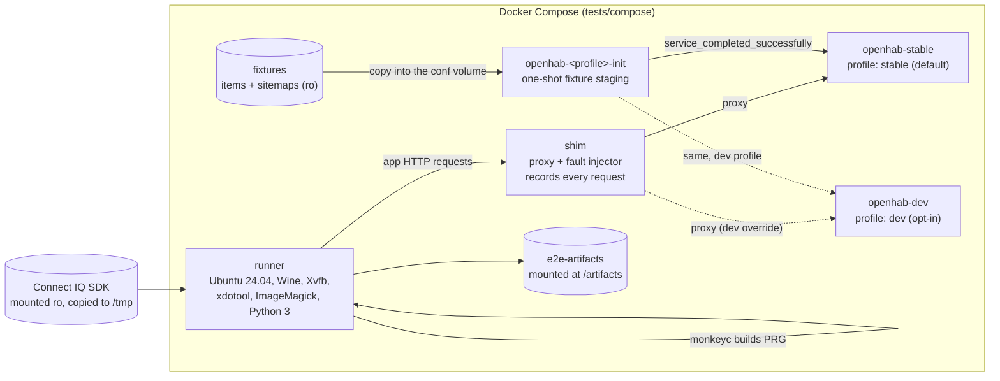

# Harness architecture

## Components



| Component | Responsibility | Never does |
| --- | --- | --- |
| `runner` | build the PRG, drive one simulator, run steps, assert, report | contain or download the SDK |
| `shim` | record requests, inject scripted faults | know about the app's internals |
| `openhab-<profile>-init` | seed the conf volume with `dist/conf` and the fixture tree, then exit | stay running, serve requests |
| `openhab-stable` / `openhab-dev` | serve the sitemap, apply item state | talk to the app directly |
| fixtures | define item structure and the sitemap | hold item _state_ |
| `e2e-artifacts` | reports, JUnit XML, screenshots, bundles, build output | live inside the read-only checkout mount |

## Fixture staging

The fixtures are the source of truth and stay read-only, but they cannot be
mounted directly into the openHAB conf volume. The image's entrypoint ends with
`chown -R openhab:openhab /openhab` under `set -e`; the first live run on a real
host died exactly there:

```text
+ initialize_volume /openhab/conf /openhab/dist/conf
+ chown -R openhab:openhab /openhab
chown: changing ownership of '/openhab/conf/items/garmin_e2e.items': Read-only file system
```

So `openhab-stable-init` / `openhab-dev-init` run first, one-shot, and:

1. seed `/openhab/conf` from the image's `/openhab/dist/conf` **only while the
   volume is empty**. That is what the image's own `initialize_volume` does;
   because the init step leaves the volume non-empty, openHAB skips its own
   seeding and would otherwise start without the dist skeleton;
1. replace `conf/items` and `conf/sitemaps` with the fixture trees, so a second
   `up` is idempotent and a fixture removed from the repository disappears from
   the volume;
1. `chown -R openhab:openhab` is left to openHAB itself, which can now do it
   because nothing underneath `/openhab` is read-only.

The staging step uses the pinned openHAB image rather than a small helper image:
it needs `/openhab/dist/conf`, `cp`, and the same uid/gid openHAB runs as, and
it is already digest-pinned and checked by `validate-compose --check-pins`. A
helper image copying only the fixtures would skip step 1 and could break the
first start in a new way.

openHAB starts only after `condition: service_completed_successfully`, and
`validate-compose` fails when that dependency is missing, when an openHAB
service mounts the fixtures itself, when any read-only mount lands under
`/openhab`, or when a fixture source is mounted read-write.

Reset paths: `docker compose run --rm --no-deps openhab-stable-init` re-asserts
the fixture state in a running stack, and `docker compose down -v` followed by
`up` rebuilds the volumes from scratch.

## Runner start-up

The SDK is mounted read-only at `/opt/ciq-sdk` (Garmin's agreement forbids
redistribution, and the operator's SDK must not be mutated), but `monkeyc`
rewrites `$SDK/bin/default.jungle`, so the compiler cannot run from the mount:

```text
ERROR: fenix7: Error occurred while processing application jungle file:
/opt/ciq-sdk/linux/bin/default.jungle (Read-only file system)
```

`entrypoint.sh` therefore copies `/opt/ciq-sdk` to `CIQ_SDK_WORKDIR`
(`/tmp/ciq-sdk`) on every container start and exports `CIQ_SDK_ROOT` to the
copy. `CIQ_SDK_ROOT` is also declared in the image environment with the same
value: `docker exec` starts a new process from the image config and never sees
the export, so CLI commands driven through `exec` - which is how a driver talks
to the runner - would otherwise report the SDK as unconfigured. It also copies
the SDK's device definitions into **both** places the toolchains read them:
`$HOME/.Garmin/ConnectIQ/Devices` for `monkeyc`/`monkeydo`, and
`<WINEPREFIX>/drive_c/users/<user>/AppData/Roaming/Garmin/ConnectIQ/Devices`
for the simulator under Wine. Without the second one, `sdk-check` passes and
the simulator opens an error window with no device, so the UI tier silently has
nothing to render. Builds compile a jungle generated for
the device under test (see [sdk.md](sdk.md#device-scoped-jungle)), so a reduced
SDK that only defines that device is enough. The same start-up also generates
the throwaway developer key that `monkeyc -y` requires (see [sdk.md](sdk.md)).

The entrypoint also clears a stale X socket and lock before starting Xvfb. A
`docker restart` keeps the container filesystem, so the previous Xvfb's socket
survives with no server behind it; Xvfb refuses to start against it, and the
container would report healthy with nothing able to render. The files are only
removed after `xdpyinfo` says nothing is answering, and an Xvfb that never
comes up is a fatal start-up error.

The copy costs the size of the SDK in the container's writable layer on each
start; `preflight` already requires 5 GiB free disk for the stack.

The image build itself also fails when the JRE's `libfontmanager.so` cannot
resolve a shared library, measured with the loader path the JVM uses
(`$JAVA_HOME/lib:$JAVA_HOME/lib/server`). The JVM resolves its own `libjvm.so`
that way, so a plain `ldd` marks a healthy image as broken — which is what the
first guest build did. The rule lives in `runner/e2e/fontmanager.py` and is
unit-tested against recorded `ldd` output, because the check itself only runs
inside the Docker build.

## Request flow

1. The app polls `GET {shim}/rest/sitemaps/garmin_e2e`.
1. The shim matches the request against the installed fault script.
   - No match: proxy to openHAB and return its response.
   - Match: synthesise the scripted status/body/delay, or reset the connection.
1. The shim records method, target, body, outcome and duration.
1. The runner asserts on that trace, on the app's `E2E:` console events, and
   optionally on a screenshot.

Commands follow the same path: `POST {shim}/rest/items/{name}`.

Setup traffic is deliberately **not** routed through the shim. The runner seeds
item state over REST directly against openHAB, so the trace only contains what the
app did. That is what makes "exactly one command was sent" a meaningful assertion.

## Deployment profiles and exposure

The same documents run in two networking modes. Ports are never repeated in a
file: [`config/network.yaml`](../config/network.yaml) defines the loopback host
and ports, renders the `network` block in
[`compose/.env.example`](../compose/.env.example) and seeds the app settings
fixture URL (`${E2E_SHIM_URL}`, resolved from the runner's environment).

| Profile | Overlay files | Peer addressing | Host listeners |
| --- | --- | --- | --- |
| bridge, stable (default) | `compose.yaml` | Compose service aliases, container port 8080 | `127.0.0.1:<port>` only |
| bridge, dev | `compose.yaml`, `compose.dev.yaml` | `openhab-dev:8080`, `shim:8080` | `127.0.0.1:<port>` only |
| host, stable | `compose.yaml`, `compose.host.yaml` | `http://127.0.0.1:<port>` | `127.0.0.1` only |
| host, dev | the above plus `compose.dev.yaml`, `compose.host.dev.yaml` | `http://127.0.0.1:<dev port>` | `127.0.0.1` only |

The bridge profile is the portable one: it works on macOS and Windows Docker
hosts, and publishing on loopback keeps a developer machine's LAN out of the
stack. The host overlays exist for the dedicated Linux VM: they set
`network_mode: host`, drop the inherited publications with Compose's `!reset`
tag, bind the shim to `${E2E_LOOPBACK_HOST}`, and give openHAB
`-Dorg.ops4j.pax.web.listening.address=${E2E_LOOPBACK_HOST}` because its default
is `0.0.0.0`.

`python -m e2e validate-compose` validates all four files and fails when a
published port lacks a loopback host, when the host overlay addresses a peer by
hostname, or when the environment block and the fixtures disagree with
`network.yaml`. `tests/runner/tests/test_network.py` also rejects any
site-specific hostname or certificate/key material under `tests/`.

External access is **not** part of the stack. If the host must be reachable from
elsewhere, the operator terminates TLS in a reverse proxy in front of the
loopback port. No certificate, key or CA material is referenced here or stored
in the environment.

## Assertion layers

| Layer | Signal | Stability | Used by |
| --- | --- | --- | --- |
| openHAB REST state | item state after a step | high | scenarios that verify the command actually applied |
| shim request trace | method, target, body, status, reset, timing | high | `protocol` tier, all command assertions |
| app trace events (`E2E:`) | view, connection, sitemap result, command result, error class, toast, error view | high, debug builds only | `protocol` tier |
| golden screenshots | pixel difference against a reviewed baseline | medium: SDK-version sensitive | `ui` tier |

The ordering is deliberate: a failing trace assertion tells you _what_ broke, and
the screenshot tells you _how it looked_. Screenshots alone are advisory.

## Failure model

- **Assertion failure** – the step fails, the scenario stops, artifacts are kept.
- **Infrastructure failure** (openHAB/shim unreachable, driver missing) – reported
  as a failed step with the cause, never as a pass.
- **Not evaluable** (dry run without events/screenshots, `--skip-events`) – the
  step is recorded as `skipped` and counted in the report. A skipped step is never
  a success.
- **Scenario budget** (`timeout_s`) – checked before each step, so a hung simulator
  or a scripted multi-second delay cannot stall a suite indefinitely.

## Environment health

A failure only means something if the stack did not change underneath it, so
every run snapshots the containers before and after the scenarios and records
the restart counts, state, health status, memory limit, current and peak working
set, cgroup `oom_kill` counter and any kernel OOM lines in `report.json`,
`health.json`, `junit.xml` and `summary.md`.

| Verdict | Cause | Exit code |
| --- | --- | --- |
| `valid` | no container restarted, was recreated, was killed or stopped during the window | `0`, `1` on scenario failures |
| `invalid` | the stack changed during the window, so the results are not attributable to the app | `3` |
| `unknown` | the window was not measured (dry run, or the runner has no Docker access) | `0`, `1` on scenario failures |

An `invalid` run is never converted into a scenario failure and no heuristic
turns a suspicious-looking environment into a defect. The rules, the exact
Docker commands and the triage procedure are in
[docs/diagnostics.md](diagnostics.md).

## Portability boundary

This directory is the complete test unit. Everything environment-specific belongs
to the infrastructure repository:

- where the stack runs (VM, CI runner, workstation);
- how Docker is provided;
- how the stack is reached from outside the host and where TLS is terminated;
- where the SDK archive comes from;
- secrets (API tokens for openHAB admin operations, if a scenario ever needs them).

Nothing here reads a host path other than `CIQ_SDK_HOST_PATH` (mount),
`CIQ_DEVICES_HOST_PATH` (optional device definitions) and `E2E_REPO_ROOT`
(checkout mount). Nothing here contains a site-specific hostname: the dedicated
host reaches the services as `127.0.0.1` and the app settings fixtures resolve
their endpoint from the stack environment.
