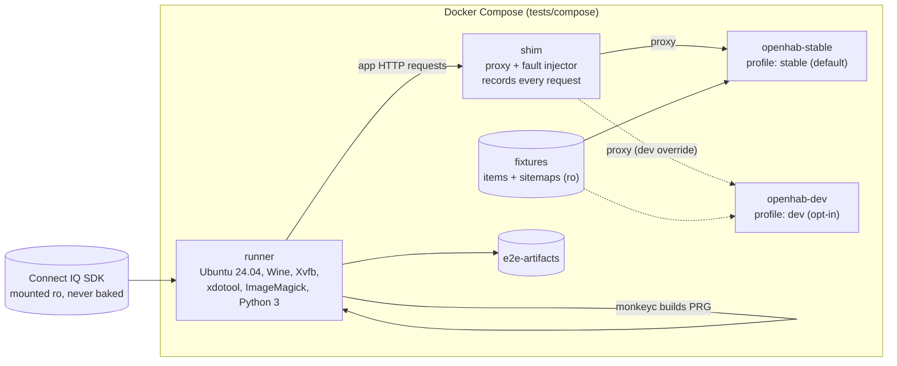

# Harness architecture

## Components

| Component | Responsibility | Never does |
| --- | --- | --- |
| `runner` | build the PRG, drive one simulator, run steps, assert, report | contain or download the SDK |
| `shim` | record requests, inject scripted faults | know about the app's internals |
| `openhab-stable` / `openhab-dev` | serve the sitemap, apply item state | talk to the app directly |
| fixtures | define item structure and the sitemap | hold item _state_ |

## Request flow

1. The app polls `GET {shim}/rest/sitemaps/garmin_e2e`.
1. The shim matches the request against the installed fault script.
   - No match: proxy to openHAB and return its response.
   - Match: synthesise the scripted status/body/delay, or reset the connection.
1. The shim records method, target, body, outcome and duration.
1. The runner asserts on that trace, on the app's `E2E:` console events, and
   optionally on a screenshot.

Commands follow the same path: `POST {shim}/rest/items/{name}`.

Setup traffic is deliberately **not** routed through the shim. The runner seeds
item state over REST directly against openHAB, so the trace only contains what the
app did. That is what makes "exactly one command was sent" a meaningful assertion.

## Assertion layers

| Layer | Signal | Stability | Used by |
| --- | --- | --- | --- |
| openHAB REST state | item state after a step | high | scenarios that verify the command actually applied |
| shim request trace | method, target, body, status, reset, timing | high | `protocol` tier, all command assertions |
| app trace events (`E2E:`) | view, connection, sitemap result, command result, error class, toast, error view | high, debug builds only | `protocol` tier |
| golden screenshots | pixel difference against a reviewed baseline | medium: SDK-version sensitive | `ui` tier |

The ordering is deliberate: a failing trace assertion tells you _what_ broke, and
the screenshot tells you _how it looked_. Screenshots alone are advisory.

## Failure model

- **Assertion failure** – the step fails, the scenario stops, artifacts are kept.
- **Infrastructure failure** (openHAB/shim unreachable, driver missing) – reported
  as a failed step with the cause, never as a pass.
- **Not evaluable** (dry run without events/screenshots, `--skip-events`) – the
  step is recorded as `skipped` and counted in the report. A skipped step is never
  a success.
- **Scenario budget** (`timeout_s`) – checked before each step, so a hung simulator
  or a scripted multi-second delay cannot stall a suite indefinitely.

## Portability boundary

This directory is the complete test unit. Everything environment-specific belongs
to the infrastructure repository:

- where the stack runs (VM, CI runner, workstation);
- how Docker is provided;
- where the SDK archive comes from;
- secrets (API tokens for openHAB admin operations, if a scenario ever needs them).

Nothing here reads a host path other than `CIQ_SDK_HOST_PATH` (mount) and
`E2E_REPO_ROOT` (checkout mount).
