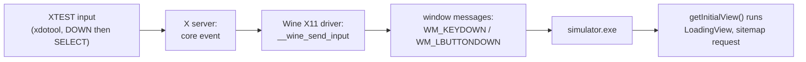

# Simulator input on the Linux guest: verdict (#402)

**Status: corrected on 2026-11-26.** The first version of this note concluded
that UI-level assertions were impossible on this host. That conclusion was
wrong. The app opens on a two-step input sequence that had not been tried —
**DOWN, then SELECT** — and the trace shows `getInitialView()` and the sitemap
request running under Wine. The earlier negative was a wrong key sequence, not
an input failure.

Input reaches the simulator. This note now records what works, what the earlier
attempts actually ruled out, and the two real defects the working run exposed.

**Revision note (2026-11-26, later measurements).** Two conclusions below are
superseded. (1) The measured sequence no longer ends in `-1001`: it reaches
`E2E:SITEMAP;result=success;code=200`, parses the sitemap and reaches
`E2E:VIEW;category=sitemap;view=HomepageMenu`; the guest driver contract is 12
pass / 0 fail / 6 skipped. (2) `Invalid Font Specified` is **not** an app or
device-definition defect: the same PRG renders with text in the Windows
simulator, Wine reports resolving every face the simulator requests, and
switching the prefix between `win7` and `win10` changes nothing. It is this
simulator build under this Wine; an older `simulator.exe` is the one open
experiment. See
[simulator-driver.md](simulator-driver.md#invalid-font-specified-under-wine).
A screenshot captured on the guest is a crashed render, so it cannot become a
golden.

## Verdict

From the glance page, pressing **DOWN** and then **SELECT** opens the app.
Measured on the guest on 2026-11-26:

```text
E2E:LANGUAGE;code=eng
E2E:CONNECTION;mode=BLE
E2E:VIEW;category=sitemap;view=LoadingView;depth=1
E2E:SITEMAP;result=error;code=-1001;bytes=-
E2E:ERRORVIEW;id=S:-1001;code=-1001
E2E:VIEW;category=error;view=ErrorView;depth=1
```

plus a real `GET /rest/sitemaps/garmin_e2e -> 200` in the shim. The sequence
matters: select alone, and DOWN/UP/select, do not open the app. With DOWN first,
the same select does.

What this changes for the design:

- **UI-level assertions are available on the existing host.** The simulator
  driver and the scenario files are the right shape; the driver needs the
  two-step readiness sequence below. No Windows host is needed for that, and
  none is available (rejected earlier on licence and capacity).
- Two open defects are app and response handling, not input:
  - the app reports `SITEMAP result=error code=-1001` while the shim served
    `200` for the same request;
  - `ErrorView.drawTextArea()` raises `Invalid Font Specified`, so the font
    problem is not limited to the glance.
- The harness has one concrete follow-up: `_open_app_if_needed` presses SELECT
  first, then an `onMenu` hold, then SELECT again, and never presses DOWN. The
  measured sequence belongs there. Until it changes, `wait_ready` and
  `app-entry` still fail even though the environment delivers input.

## The measurement

| Observation | Result |
| --- | --- |
| starting state | `E2E:VIEW;category=glance` |
| the sequence | DOWN (`nextPage`), then SELECT (`onSelect`) |
| first view after it | `E2E:VIEW;category=sitemap;view=LoadingView;depth=1` |
| request | shim logged `GET /rest/sitemaps/garmin_e2e -> 200` |
| app's own result | `E2E:SITEMAP;result=error;code=-1001` |
| next view | `E2E:ERRORVIEW;id=S:-1001;code=-1001`, then `category=error;view=ErrorView` |

> Superseded by the revision note above: a later run with the same sequence
> measured `E2E:SITEMAP;result=success;code=200` and
> `E2E:VIEW;category=sitemap;view=HomepageMenu`. The table stays as the record
> of the earlier run.

That `getInitialView()` runs and `SitemapRequest.start()` is called is the
important part: the widget is no longer stuck in glance mode, and the input path
from the X server through Wine to the app is proven end to end.

## What the earlier attempts ruled out — and why the conclusion was wrong

Every measurement below is accurate. The conclusion drawn from them was not:
each tested sequence pressed SELECT first, and the glance carousel needs DOWN
before SELECT opens the app. The section is kept as history so it is not
re-derived as current evidence.

| Candidate | What was measured | Why it did not settle input |
| --- | --- | --- |
| SELECT alone | no view change | the wrong sequence; DOWN comes first |
| DOWN, UP, SELECT | no view change | the UP moves the carousel back to the starting item; only DOWN then SELECT is measured to open the app |
| device event versus XTEST | a uinput pointer moved the pointer; a select-first click was silent | still the wrong sequence, so the event source was never the variable |
| coordinates and hit areas | declared `enter` area and screen centre both silent | same sequence problem |
| focus | the simulator window held focus at the click | focus was never the problem |
| Wine | `winecfg` accepted input and closed on `Tab, Tab, Return` | Wine was never the problem |
| X server | the device run used Xorg with a real device | the event source was never the problem |
| timing | a second click and a 15 s wait changed nothing | same sequence problem |

The earlier device run is still useful history: it proved that a real evdev
device can be attached to a dummy-video Xorg, that the kernel receives the
injected events and that the pointer moves with XI2 reporting it. It did not
prove anything about the simulator's response, because the click was at the
wrong step.

## Mechanism, from source

These findings are unchanged and explain why the input path was never the
problem. Wine 9.0 and xorg-server 21.1; Wine files at tag `wine-9.0`.

### M1 — XTEST is an ordinary XI2 slave and generates raw events

`Xext/xtest.c` `ProcXTestFakeInput()` resolves the request to the virtual XTEST
device and queues it through `GetPointerEvents()` or `GetKeyboardEvents()`
without `POINTER_NORAW`. `dix/getevents.c` `fill_pointer_events()` allocates a
`RawDeviceEvent` whenever `(flags & POINTER_NORAW) == 0`, and the key path
generates a raw event for `EVENT_SOURCE_NORMAL`.

### M2 — Wine turns every core X event into a Win32 hardware message

`dlls/winex11.drv/mouse.c` `X11DRV_ButtonPress`, `X11DRV_ButtonRelease` and
`X11DRV_MotionNotify` call `send_mouse_input()` → `__wine_send_input()`; the
keyboard path is `X11DRV_send_keyboard_input()`. `dlls/win32u/input.c`
`__wine_send_input()` calls `send_hardware_message(..., 0)`, not the
`SEND_HWMSG_INJECTED` path that `NtUserSendInput()` uses.

### M3 — `WM_INPUT` is synthesised from the same hardware message

`dlls/win32u/rawinput.c` `process_rawinput_message()` builds the `RAWINPUT`
record from `struct hardware_msg_data`; `server/queue.c` `queue_mouse_message()`
and `queue_keyboard_message()` build that same structure and call
`enum_processes( queue_rawinput_message, &raw_msg )` before queueing the legacy
message. A raw-input consumer cannot see one without the other.

### M4 — the only genuinely XI2-raw input in Wine is relative motion

`mouse.c` selects `XI_RawMotion` (plus `XI_ButtonPress`/`XI_DeviceChanged` for
slave tracking) on the root window and maps a raw motion event to
`MOUSEEVENTF_MOVE` in `X11DRV_RawMotion()`. That is relative-motion support, not
a button or key path.

### M5 — raw input asks for a Win32 foreground window (not reached here)

`server/queue.c` `queue_rawinput_message()` drops `WM_INPUT` when the receiving
process is not the foreground process unless it registered `RIDEV_INPUTSINK`,
and `queue_mouse_message()`/`queue_keyboard_message()` return before the legacy
message for a process that registered `RIDEV_NOLEGACY`. Correct reading of the
code, and not relevant to the verdict: the sequence reaches the app.

### M6 — Wine filters only its own pointer warps

`mouse.c` `X11DRV_SetCursorPos()` and the cursor-clipping path set
`warp_serial`, and `is_old_motion_event()` discards motion whose serial predates
it. That applies to warps Wine itself performs, not to an external client's
`XWarpPointer`. Recorded because it was once proposed as an explanation; the
sequence finding makes it moot.

### M7 — there is no Wine raw-input switch to configure

`dlls/winex11.drv/x11drv_main.c` reads only the usual `X11 Driver` values
(`Managed`, `Decorated`, `UseXVidMode`, `UseXRandR`, `UseTakeFocus`,
`UsePrimarySelection`, `UseSystemCursors`, `GrabFullscreen`, `ScreenDepth`,
`ClientSideGraphics`, `ClientSideWithRender`, `UseXIM`, `ShapeLayeredWindows`,
`PrivateColorMap`, `PrimaryMonitor`, `CopyDefaultColors`, `AllocSystemColors`,
`InputStyle`). None of them is a raw-input or XInput2 switch.

### M8 — a device event is not synthetic, but Wine adds no synthetic flag

An XTEST event is a device event of the virtual XTEST slave; a uinput event is a
device event of a real slave. Both become core X events and both are converted
by `__wine_send_input(..., 0)`; `server/queue.c` sets `LLMHF_INJECTED` only for
`IMO_INJECTED`, which is the `SendInput` path. A device cannot help through a
synthetic flag because there is none. The device run's silence is now explained
by the sequence, not by the event source.



## The two genuine findings

### The app returns `-1001` for a request the shim answered with 200

The shim logged `GET /rest/sitemaps/garmin_e2e -> 200`, and the app reported
`E2E:SITEMAP;result=error;code=-1001` for that request. That contradiction is
not explained here and is not an input problem. It is the next thing to
investigate in the request path: either the response the app received differs
from what the shim logged, or the app maps a successful response to `-1001`.

### `Invalid Font Specified` is not glance-only

`ErrorView.drawTextArea()` raises `Invalid Font Specified` under Wine. The
glance earlier showed the same failure (`GlanceSitemapView.mc:99`), and the
working run shows it is not limited to the glance. **Superseded:** it is not an
app or device-definition defect — the same PRG renders on Windows and Wine
resolves every requested face. It is this simulator build under this Wine (see
the revision note above and
[simulator-driver.md](simulator-driver.md#invalid-font-specified-under-wine)).

## Residual limits

- Input works for the measured button path (DOWN then SELECT). The equivalent
  sequence for a touch-only device was not measured in this correction.
- The driver's readiness path does not use the sequence yet:
  `_open_app_if_needed` tries SELECT, an `onMenu` hold, SELECT again and a
  relaunch. Until that changes, `wait_ready` still leaves the app on the glance.
- Error-view rendering fails on the font error, so a run that reaches the error
  view cannot be asserted visually yet.
- The `-1001` handling is open (above).
- The measurement's device and exact command are not recorded in the trace; the
  sequence is the measured fact.

## Hygiene

- Disposable containers are `--rm`; `docker ps -a | grep ciq-input-spike` must
  be empty.
- `wineserver -k` inside a disposable container before it exits if a simulator
  was started by hand; a stray simulator makes the next run look like a launch
  failure (see
  [simulator-driver.md](simulator-driver.md#cold-starts-and-the-stray-simulator-hazard)).
