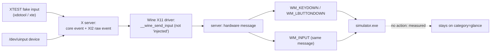

# Simulator input on the Linux guest: verdict (#402)

**Status: closed by measurement.** The decisive run was made by the operator on
the guest on 2026-11-25, in a disposable container, with the shared stack
untouched. The author wrote this document from those measurements and from the
Wine and xorg-server source. No application source, scenario, image or compose
file was changed to reach it.

Scope: the Windows Connect IQ simulator (SDK 9.3.0) under Wine 9.0 on the Ubuntu
24.04 guest, with Xorg or Xvfb as the display.

## Verdict

**UI-level assertions are not available on this host.** A device-backed
pointer — a real uinput evdev device attached to Xorg, with the pointer confirmed
moving to an exact declared coordinate — does not make the simulator act. Clicks
on the declared `enter` hit area and on the screen centre leave the app on
`E2E:VIEW;category=glance`, with no trace change and no request. The simulator
ignores pointer input under Wine regardless of how that input is produced.

The raw-input explanation that motivated the spike is refuted by source
(M1–M4): XTEST is an ordinary XI2 slave and generates raw events, and Wine
builds `WM_INPUT` from the same hardware message as the legacy mouse and key
messages. The measured device run then closes the only remaining input-side
difference: a non-XTEST device that demonstrably moves the pointer changes
nothing.

What this means for the design:

- A Windows host was rejected on licence and capacity, so it is not a fallback.
- The remaining route to anything visual is the off-screen work in #403:
  construct a view, draw it into a `BufferedBitmap` device context and use real
  font metrics to assert that text fits. SDK 9.3.0 has no `getPixel` or drawing
  readback (design note in [visual-truth.md](visual-truth.md), commit `353a313`), so
  that tier can prove drawing and text fit, not colours or rendered pixels.
- The harness stays host-independent. The driver interface (`null`, `wine`,
  `windows`) and the scenario files do not encode the host. If Windows or a
  working Wine input path ever exists, the same scenarios should run unchanged;
  that is the only conditional case, and nothing in this change prepares for it
  beyond leaving the interface and scenarios alone.
- `press`, `tap`, `app-entry`, `input-delivery`, `press-effect` and
  `press-sequence` stay as they are. Their failing state on the guest is the
  accurate record, not a regression to chase.

## The decisive measurement

Measured end to end on the guest, disposable container, every gate passed:

| Gate | Result |
| --- | --- |
| uinput device (`BTN_LEFT`, `REL_X`, `REL_Y`) | created; `evemu-describe` confirms |
| Xorg evdev attach | `xinput list`: `↳ vmmouse id=6 [slave pointer]` |
| motion by device injection | `960,540` → `382,209`, exact declared target, 18 capped steps |
| focus | `xdotool getwindowfocus` = simulator window |
| click on declared `enter` hit area | AE 0, trace unchanged, no requests |
| click on screen centre | same |
| second click + 15 s | same |

Trace throughout: `E2E:LANGUAGE;code=eng`, `E2E:VIEW;category=glance`, nothing
else; the shim recorded no request.

Each alternative explanation was verified independently before the verdict was
drawn:

| Candidate | Status |
| --- | --- |
| Windows host needed because Wine ignores synthetic input | rejected: `winecfg` closes on `Tab, Tab, Return` under the same display; the failure is the simulator, not Wine |
| XTEST versus a device event | rejected: a uinput evdev device moved the pointer to the exact target; clicks still had no effect |
| Coordinates and hit areas | rejected: the declared `enter` area and the screen centre were both silent |
| Focus | rejected: the simulator window held focus at the click |
| Device capabilities | rejected: `BTN_LEFT`, `REL_X` and `REL_Y` were present and `evemu-describe` confirmed them |
| X server | rejected: this ran on Xorg with a real device, not on Xvfb with XTEST |
| Timing | rejected: a second click and a 15 s wait changed nothing |

## Mechanism, from source

Environment: Ubuntu 24.04, `wine 9.0~repack-4build3` (the image's
`wine`/`wine32:i386`), xorg-server 21.1. Wine files are at tag `wine-9.0`; the
X files are from the public xorg-server sources.

### M1 — XTEST is an ordinary XI2 slave and generates raw events

`Xext/xtest.c` `ProcXTestFakeInput()` resolves the request to the virtual XTEST
device (`dev = GetXTestDevice(dev)`) and queues it through `GetPointerEvents()`
or `GetKeyboardEvents()` **without** `POINTER_NORAW`. `dix/getevents.c`
`fill_pointer_events()` allocates a `RawDeviceEvent` whenever
`(flags & POINTER_NORAW) == 0`, and the key path generates a raw event when the
source is `EVENT_SOURCE_NORMAL`. XTEST therefore looks like any other device to
the X server.

### M2 — Wine turns every core X event into a Win32 hardware message

`dlls/winex11.drv/mouse.c` `X11DRV_ButtonPress`, `X11DRV_ButtonRelease` and
`X11DRV_MotionNotify` call `send_mouse_input()` → `__wine_send_input()`; the
keyboard path is `X11DRV_send_keyboard_input()` in
`dlls/winex11.drv/keyboard.c`. `dlls/win32u/input.c` `__wine_send_input()`
calls `send_hardware_message(..., 0)`, not the `SEND_HWMSG_INJECTED` path that
`NtUserSendInput()` uses. To the Windows side, an XTEST event is not marked as
injected.

### M3 — `WM_INPUT` is synthesised from the same hardware message

`dlls/win32u/rawinput.c` `process_rawinput_message()` builds the `RAWINPUT`
record from `struct hardware_msg_data`; `server/queue.c` `queue_mouse_message()`
and `queue_keyboard_message()` build that same structure and call
`enum_processes( queue_rawinput_message, &raw_msg )` before queueing the legacy
message. A raw-input consumer cannot see one without the other.

### M4 — the only genuinely XI2-raw input in Wine is relative motion

`mouse.c` selects `XI_RawMotion` (plus `XI_ButtonPress`/`XI_DeviceChanged` for
slave tracking) on the root window and maps a raw motion event to
`MOUSEEVENTF_MOVE` in `X11DRV_RawMotion()`. That is relative-motion support, not
a button or key path.

### M5 — raw input asks for a Win32 foreground window, and `RIDEV_NOLEGACY` removes the fallback

`server/queue.c` `queue_rawinput_message()` drops `WM_INPUT` when the receiving
process is not the foreground process unless it registered `RIDEV_INPUTSINK`,
and `queue_mouse_message()`/`queue_keyboard_message()` return before the legacy
message when the sending process registered `RIDEV_NOLEGACY`. This was the
strongest Wine-internal explanation while input was unexplained. It is recorded
because it is the correct reading of the code, not because it survived: the
measured run rules out the whole input path, not just this branch of it.

### M6 — the harness moves the pointer by warping, and Wine filters only its own warps

`mouse.c` `X11DRV_SetCursorPos()` and the cursor-clipping path set
`warp_serial`, and `is_old_motion_event()` discards motion whose serial predates
it. That applies to warps Wine itself performs, not to an external client's
`XWarpPointer`; the earlier belief that this explained the silence was wrong.
Recorded so the next reader does not revive it.

### M7 — there is no Wine raw-input switch to configure

`dlls/winex11.drv/x11drv_main.c` reads only these `HKCU\Software\Wine\X11 Driver`
values: `Managed`, `Decorated`, `UseXVidMode`, `UseXRandR`, `UseTakeFocus`,
`UsePrimarySelection`, `UseSystemCursors`, `GrabFullscreen`, `ScreenDepth`,
`ClientSideGraphics`, `ClientSideWithRender`, `UseXIM`, `ShapeLayeredWindows`,
`PrivateColorMap`, `PrimaryMonitor`, `CopyDefaultColors`, `AllocSystemColors`
and `InputStyle`. None enables, disables or configures raw input or XInput2.
`InputStyle` only changes pointer-grab semantics.

### M8 — a device event is not synthetic, but Wine adds no synthetic flag

An XTEST event is a device event of the virtual XTEST slave; a uinput event is a
device event of a real slave with its own name, capabilities and identity. Both
become core X events and both are converted by `__wine_send_input(..., 0)`;
`server/queue.c` sets `LLMHF_INJECTED` only for `IMO_INJECTED`, which is the
`SendInput` path. A device therefore cannot help through a synthetic flag —
there is none. The measured run shows it does not help through device identity
either, which is what the last candidate required.

## Reproducing the decisive run

This is the method that produced the table, not a list of further experiments.
Everything ran in a disposable container from the pinned runner image, with the
live `runner`, `shim` and openHAB containers untouched:

- `docker run --rm --device /dev/uinput --device-cgroup-rule 'c 13:* rmw'
  -v /dev/input:/dev/input ...` — the host's udev creates the `/dev/input`
  nodes; the container needs no udev of its own.
- One owner process (`evdev.UInput`) created a keyboard and a mouse with
  `BTN_LEFT`, `REL_X` and `REL_Y` **before** Xorg started, kept the device alive
  for the whole run and injected through the same uinput file descriptors. No
  second creator and no path-based injection; that is what made the run
  repeatable.
- `Xorg :98` with the dummy video driver and the `evdev` input driver, the
  explicit `/dev/input/eventN`, `SendCoreEvents`, `AlwaysCore`,
  `GrabDevice false`, and `Option "AutoAddDevices" "off"` in `ServerLayout`.
  Pass criteria: `Using input driver 'evdev'`, `Configuring as mouse`,
  `xinput list` showing a slave pointer, and two `EV_REL` injections changing
  `xdotool getmouselocation`.
- The simulator and `monkeydo` ran unchanged. The pointer was placed by warp,
  moved onto the target by the device in capped steps, clicked on the declared
  `enter` hit area and on the screen centre, and checked against an idle
  baseline and the trace.

Bounds: 18 motion steps, three click attempts, a 15 s wait, and no unbounded
`read` or `sleep`. That is why this run finished where an earlier attempt hung.

## Limits of this record

- The Win32 message trace (`WINEDEBUG=+message`) was not taken. It could say
  where inside Wine the event stops, but no remaining candidate is a deployable
  change on this host, so it would not change the design conclusion.
- The XTEST raw-event case was verified from source, not measured; the device
  case was measured (`RawMotion` and `Motion` from the uinput pointer).
- The simulator's internal reason for ignoring pointer input is not known and
  this document does not guess at it.
- The result is for the SDK 9.3.0 simulator under Wine 9.0 on this X server. A
  different simulator build or a fixed Wine input path could behave differently;
  the harness would then be exercised by the existing scenarios, unchanged.

## Cleanup

- The disposable containers are `--rm`; `docker ps -a | grep ciq-input-spike`
  must be empty.
- An interrupted run must not leave an Xorg on `:98` or a `spike-kbd`/
  `spike-mouse` device behind: check `pgrep -a Xorg` and
  `grep -H . /sys/class/input/*/name`; both disappear when their owning process
  exits.
- `wineserver -k` inside a disposable container before it exits if a simulator
  was started by hand; a stray simulator makes the next run look like a launch
  failure (see
  [simulator-driver.md](simulator-driver.md#cold-starts-and-the-stray-simulator-hazard)).
